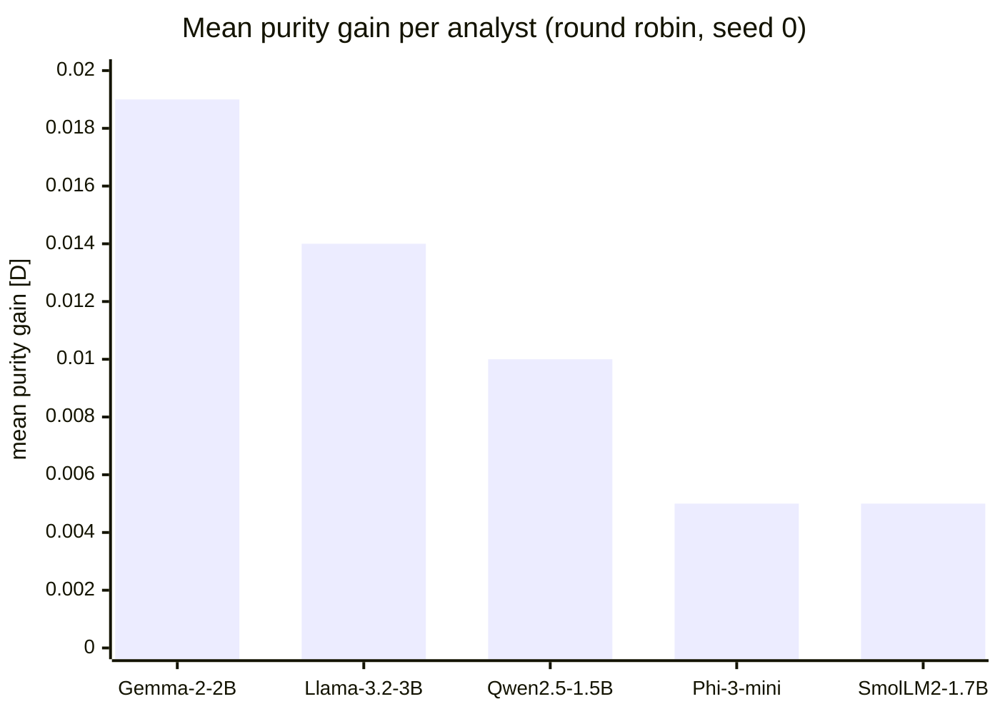
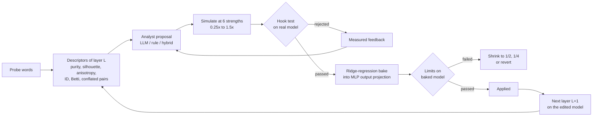

<div align="center">

# Topology-Aware Weight Baking

**Can AI Mature a Model's Geometry? Training-Free Weight Baking in LLMs**


</div>

A local LLM "analyst" reads topological and geometric descriptors of one layer of a frozen "target" model and proposes a small geometric transformation of that layer's feature space. The system simulates the proposal, tests it on the real model against behaviour limits, and compiles the verified transformation into the target's weights by closed-form ridge regression, layer by layer, with no gradient descent. **Topology shows what to change; ridge regression writes the change.**

This repository contains the full pipeline and every ablation study of the paper, the evaluation, the statistics, the data-preparation script, and the data files.

> **Paper:** A. Golnari and S. Sanei, *Can AI Mature a Model's Geometry? Training-Free Weight Baking in LLMs* (manuscript, VinUniversity). See [Citation](#citation).

## Contents

[Key idea](#key-idea) · [Main results](#main-results) · [Pipeline](#pipeline) · [Installation](#installation) · [Data](#data-preparation) · [Quick start](#quick-start) · [Studies](#studies) · [Round robin](#round-robin-setting) · [Outputs](#outputs) · [Acceptance limits](#acceptance-limits) · [Hardware](#hardware-and-runtime-notes) · [Layout](#repository-layout) · [Limitations](#limitations) · [Citation](#citation) · [License](#license)

## Key idea

Intermediate feature spaces of language models are usually treated as flat Euclidean spaces, yet unrelated concepts often sit close together. Instead of letting an LLM read raw weights (which does not scale with model size), the analyst sees a **fixed-size digest** of descriptors whose length depends on the number of categories, not on the parameter count of the target:

| descriptor level | content |
|---|---|
| (i) | current and original neighbourhood purity *P* and silhouette *S*, the six most conflated category pairs, purity per category, the eight least pure words |
| (ii) | anisotropy κ, mean norm, explained-variance spectrum of the first six components |
| (iii) | intrinsic dimensions and Betti numbers β₀, β₁ |
| (iv) | ratio of intra- to inter-category distance, drift caused by upstream edits |

The analyst answers with a JSON object of at most four operations, compiled into one affine map `T(h) = hA + b`:

| operation | effect |
|---|---|
| `separate` | stretches or contracts the space along the line joining two category centroids |
| `scale_pcs` | rescales listed principal components |
| `whiten` | equalizes the variance of the top components |
| `center` | subtracts part of the mean vector |

"Mature" is used in an operational sense: after the edit, the representations of one concept lie closer together, different concepts are better separated, and fewer directions dominate the space, on words and sentence frames the editor never saw, while behaviour is preserved.

## Main results

All numbers below are taken from the paper. Lightweight models only: a 2.6B-parameter analyst (Gemma-2-2B) and 1.5B / 1.7B targets (Qwen2.5-1.5B, SmolLM2-1.7B). Geometry is measured on **unseen words in unseen sentence templates** (condition `[D]`).

- **Geometry matured in every default run.** Category purity rose in all 6 default runs (+0.010 to +0.029 over the edited layers; +0.026 to +0.061 at the last layer). Silhouette rose, anisotropy fell, and the Betti numbers β₀ and β₁ of the point cloud fell.
- **Behaviour preserved.** No benchmark change (HellaSwag, ARC-Easy, TruthfulQA) exceeded the sampling error; every analyst run changed by at most 0.030. Cloze accuracy rose on probe words in all six runs.
- **The change is in the weights.** No hook remains at inference time; relative weight change of at most 0.096; median ridge fit R² of 0.9995.
- **The analyst matches a category-aware heuristic with gentler edits**: in all six seed-matched pairs it had lower cumulative KL and higher CKA to the original model, with one operation per edit against 2.5 to 2.8 for the heuristic.
- **The analyst uses the topology it is shown.** Gains depend on the descriptor level; the full digest was the only level with a purity gain above 0.010 in every run on both targets.
- **The sequential loop is required.** Applying all edits at once (parallel control) raised KL by a factor of 7.7 to 14.6 for the LLM arm and destroyed the heuristic arm (KL 4.0 to 5.6 nats per token).
- **Round robin over five models.** 16 of 20 analyst–target pairs changed their target and **all 16 raised purity** on unseen material (+0.002 to +0.033); the other four left the target unchanged.

Purity gain under `[D]` in the round robin (default configuration, seed 0; number of accepted edits in parentheses; `0 (0)` = no accepted edit):

| analyst ↓ / target → | Gemma-2-2B | Llama-3.2-3B | Phi-3-mini | Qwen2.5-1.5B | SmolLM2-1.7B | mean |
|---|---|---|---|---|---|---|
| **Gemma-2-2B** | – | .016 (20) | .022 (21) | .029 (13) | .011 (13) | **.019** |
| **Llama-3.2-3B** | .010 (6) | – | .010 (20) | .022 (18) | .014 (13) | **.014** |
| **Phi-3-mini** | 0 (0) | .005 (27) | – | .007 (21) | .007 (9) | **.005** |
| **Qwen2.5-1.5B** | 0 (0) | .033 (1) | .003 (1) | – | .006 (1) | **.010** |
| **SmolLM2-1.7B** | 0 (0) | .002 (10) | .018 (7) | .000 (2) | – | **.005** |
| **mean** | .003 | .014 | .013 | .014 | .010 | .011 |



The gain did not grow with parameter count (Phi-3-mini, the largest model, had a mean gain of only 0.005). The gains are modest in absolute terms and come at a cost in held-out perplexity (+6.5% to +8.7% for the LLM arm on the main-study targets) and in factual margin; the paper does not claim the edited models are better trained behaviourally. Full tables are in the paper's appendix and in `results/ABLATION_SUMMARY.md` after a run.

## Pipeline

For every layer of a target, from the first to the last:

1. **Describe** the layer on the probe words (kNN purity, silhouette, anisotropy, PCA spectrum, intrinsic dimension, Betti numbers, conflated category pairs). Layers that are already clean (*P* ≥ 0.95, or no category pair conflated above 0.05) are skipped.
2. **Propose.** An analyst (an LLM, a rule-based proposer, or both) proposes up to four operations. Failed proposals come back with the measured numbers (up to three attempts per layer); the system picks the strongest strength of the proposal (0.25x to 1.5x) that passes every limit.
3. **Hook test (stage one).** The edit is tested through a forward hook on the real model: KL to the previous and to the original model, perplexity, linear CKA of the layer, HellaSwag monitor accuracy.
4. **Bake (stage two).** The edit is compiled into the MLP output projection of the block by ridge regression on calibration text. All tests are repeated on the baked model; if a limit fails, the weights are restored and the edit is baked again at half and a quarter strength, or reverted. Safety limits are never relaxed.
5. **Recompute.** The next layer is described on the model that already contains all upstream edits.



**Arms.** `llm`: only analyst proposals are applied. `rule`: no LLM is loaded; a deterministic category-aware heuristic stretches the most conflated category pairs. `hybrid`: the heuristic backs up the analyst when it fails.

## Installation

Python 3.9 or newer.

```
git clone https://github.com/amingolnari/weight-baking.git
cd weight-baking
pip install -r requirements.txt
```

Install PyTorch first for your CUDA version (see the PyTorch website), then the requirements. Optional packages:

- `ripser`: persistent homology (Betti-1). Without it Betti-1 is reported as 0 and `h1_computed` is 0; everything else works.
- `bitsandbytes` (with `accelerate`): needed only for an analyst entry whose `analyst_repo` name contains `bnb-4bit`, which is loaded in 4-bit.

The paper's results were produced with PyTorch 2.5.1 (CUDA 12.1), transformers 4.57.6, ripser 0.6.15 and scikit-learn 1.7.2. `requirements.txt` lists lower bounds only.

## Data preparation

The four data files used in the paper are already in `data/`, so you can go straight to the [quick start](#quick-start). To rebuild them:

```
python scripts/build_data.py --wordnet --per-category 250 --wikitext
```

The first run needs internet access (WordNet corpus, WikiText-103). It writes four files to `data/` (change the folder with `--out-dir`):

| file | content |
|---|---|
| `probe_words.txt` | `word<TAB>category`, about 250 words per category from WordNet (frequency-ranked single-word lemmas, not hand-curated). The first 8 categories (in order of first appearance) are the core set (animal, fruit, vehicle, tool, color, country, emotion, profession); 16 are needed for the category-count study. |
| `calibration_sentences.txt` | WikiText-103 validation sentences, used to fit the closed-form weight edit. |
| `heldout_sentences.txt` | WikiText-103 test sentences. The first 24 are the in-loop guard set, the rest (476) is used for evaluation only. |
| `new_domain_sentences.txt` | Template-generated code, medical, legal, chat and finance sentences (evaluation only). |

Other options: `--n-calibration` (200), `--n-heldout` (500), `--n-new-domain` (500), `--seed` (0), and `--check`, which prints the words per category and a few sample lines. Without `--wordnet` and `--wikitext` the script writes short placeholder files (marked `PLACEHOLDER` in their first line); the analysis warns when it finds them. Lines starting with `#` are comments.

For each seed, 20% of the words of every category are set aside as **unseen words** (1,359 probe and 341 unseen words for 8 categories); edits are chosen and fitted on the probe words only. The probe template is "I thought about the {w}"; three further templates are never used for editing, which gives four evaluation conditions:

| condition | words | template |
|---|---|---|
| `[A]` | probe (in-sample) | probe |
| `[B]` | unseen | probe |
| `[C]` | probe | unseen |
| `[D]` | unseen | unseen (full out-of-distribution transfer) |

## Quick start

One study, one seed:

```
python scripts/run_ablation.py --ablation-type baseline --num-runs 1
```

Everything (all studies, 3 seeds, then tables, plots and the summary):

```
python scripts/run_ablation.py
```

Defaults: analyst `gemma-2-2b-it`, targets `qwen2.5-1.5b-it` and `smollm2-1.7b-it`, 8 categories, seeds 0 to 2. This is the main study of the paper (126 runs). Models and benchmark datasets are downloaded on first use. Finished runs are skipped on restart, and an interrupted sequential run resumes at the layer where it stopped.

All locations are relative to the working directory: `data/`, `models/`, `cache/` (benchmark datasets), `results/`, `plots/`, and the summary file `results/ABLATION_SUMMARY.md`. Override them with `--data-dir`, `--models-dir`, `--cache-dir`, `--results-dir`, `--plots-dir`, `--summary`, or set the environment variable `TOPOBAKE_HOME` to use one base folder for all of them (a flag always wins). Other flags: `--analysts`, `--targets`, `--arms`, `--num-runs`, `--seed0`, `--num-categories`, `--category-counts`, `--alphas`, `--gains`, `--holdout`, `--n-bench`, `--main-results`, `--analyze-only`. Run `python scripts/run_ablation.py --help` for the full list.

## Studies

Select with `--ablation-type` (several names may be given; default `all`).

| study | what it isolates | variants | arms |
|---|---|---|---|
| `baseline` (alias `repeats`) | Whether the default pipeline's changes differ from zero (confidence intervals, p-values). | default configuration repeated over seeds | llm, rule |
| `non_sequential` | The benefit of analysing each layer on the already-edited model. | sequential loop vs a parallel control (all layers analysed on the original model, edits applied together) | llm, rule |
| `analyst_type` | Who should write the edits. | the arms themselves | llm, rule, hybrid |
| `descriptors` | Which descriptors the analyst needs. | purity+silhouette, +anisotropy, +intrinsic dimension and Betti numbers, full | llm |
| `strength` | The effect of the strength factor alpha. | adaptive search, and fixed alphas from `--alphas` | rule |
| `gain_threshold` | How strict the acceptance threshold should be. | thresholds from `--gains`, relaxed-threshold stage off | rule |
| `categories` | Whether the method scales with the number of probe categories. | counts from `--category-counts` (4, 8, 16) | llm, rule |

A run is one configuration (arm, analyst, target, mode, descriptors, alpha, gain threshold, categories, seed); a configuration shared by several studies is executed once. Seeds change the probe/unseen word split, the benchmark samples and the HellaSwag monitor sample (they resample data on the same frozen weights, so they are not independent replications).

The **default configuration** is the sequential loop with adaptive strength, the full digest, a gain threshold of 0.01 with the relaxed stage, and eight categories.

## Round-robin setting

Every model of the pool is edited by every other model (20 runs, default LLM configuration, seed 0). Pairs with the same analyst and target are skipped; the rule-based arm runs once per target.

```
python scripts/run_ablation.py --ablation-type baseline analyst_type \
    --analysts qwen2.5-1.5b-it llama-3.2-3b-it phi-3-mini-it gemma-2-2b-it smollm2-1.7b-it \
    --targets qwen2.5-1.5b-it llama-3.2-3b-it phi-3-mini-it gemma-2-2b-it smollm2-1.7b-it
```

The pool and its optional per-entry keys (`target`, `analyst`, `analyst_repo`) are defined in `topobake/config.py`.

Rebuild the tables, plots and summary from saved runs without running any model:

```
python scripts/run_ablation.py --analyze-only
```

Add `--main-results <runs_summary.csv>` to include the runs of a separate main study in the analyst-efficiency plot and the transfer matrix.

## Outputs

| location | content |
|---|---|
| `results/runs/<run id>/summary.json` | one-row summary of a run (configuration, accepted edits, changes in geometry, CKA, KL, perplexity, benchmarks) |
| `results/runs/<run id>/<arm>/<analyst>/<target>/` | the run folder: `pipeline_log.csv` (one row per layer), `layerNN/` (descriptor tables and `analyst_log.json`), `state/` (applied layers and the weight delta of every edit), `eval_layers.csv`, `per_category_layers.csv`, `cka.csv`, `eval_behaviour.csv` |
| `results/manifest.csv` | which run belongs to which study and variant |
| `results/all_runs.csv` | every run summary in one table |
| `results/repeated_runs_stats.csv`, `repeated_runs_by_pair.csv`, `ablation_<study>.csv` | statistics per study (mean, sd, 95% interval, p-values, paired comparison against the reference variant) |
| `results/per_category_gains.csv`, `analyst_efficiency.csv`, `transfer_matrix.csv` | category-level gains, gain per unit of KL, transfer from probe words to unseen words and frames |
| `plots/ablation_<study>.png`, `trajectory_<run id>.png`, `analyst_efficiency.png`, `per_category_gains.png`, `transfer_matrix.png` | figures |
| `results/ABLATION_SUMMARY.md` | for each study: purpose, setup, table of means with 95% intervals, findings read off the table |

The run id is readable and ends in the first 8 hex digits of the MD5 of the configuration, e.g. `llm_gemma-2-2b-it_qwen2.5-1.5b-it_seq_full_aadaptive_g0.01_c8_s0_90245c3b` (arm, analyst, target, mode, descriptors, alpha, gain threshold, categories, seed, hash).

## Acceptance limits

Every edit must pass all limits on the hooked model and again on the baked model (the weight budget and the HellaSwag monitor apply to the baked update only). The divergence, perplexity and CKA limits are measured on a guard set of 24 held-out sentences that is disjoint from the evaluation data.

| quantity | limit |
|---|---|
| operations per edit | ≤ 4 |
| mean relative feature change | ≤ 0.20 |
| gain ΔP + ΔS | ≥ 0.01 (10⁻⁶ in the relaxed stage) |
| KL per edit; cumulative (nats per token, guard set) | ≤ 0.05; ≤ 0.30 |
| guard-set perplexity, per edit; cumulative | ≤ +2%; ≤ +5% |
| per-edit layer CKA (probe words, guard tokens) | ≥ 0.95 |
| HellaSwag monitor drop (100 examples) | ≤ 0.05 |
| relative weight change ‖ΔW‖<sub>F</sub> / ‖W‖<sub>F</sub> | ≤ 0.10 |

## Hardware and runtime notes

- All paper runs used a single NVIDIA H100 (80 GB). Wall-clock time of a default sequential run: 15.5 to 19.0 min (LLM arm), 13.1 to 15.7 min (heuristic arm), 17.8 to 22.4 min (hybrid arm), 7.9 to 10.0 min (parallel control); a round-robin run took 4.7 to 42.7 min. The full 126-run main study is therefore a matter of GPU-days, not hours; use `--ablation-type baseline --num-runs 1` for a first check.
- Targets are loaded and edited in float32, so that small weight changes are not rounded away and hidden states stay finite. Analysts are read-only and loaded in bfloat16 on a GPU (float32 on CPU); an analyst entry whose repository name contains `bnb-4bit` is loaded in 4-bit and needs a CUDA GPU.
- The code uses a GPU when `torch.cuda.is_available()`; otherwise it runs on CPU.
- Pool models (layers, hidden size): `qwen2.5-1.5b-it` (28, 1536), `llama-3.2-3b-it` (28, 3072), `phi-3-mini-it` (32, 3072), `gemma-2-2b-it` (26, 2304), `smollm2-1.7b-it` (24, 2048).
- Checkpoint saving is off by default. The weight delta of every applied edit is always saved (`state/delta_layer<N>.pt`), which is what makes interrupted runs resumable.
- Each benchmark (HellaSwag, ARC-Easy, TruthfulQA) is subsampled to 200 examples (`--n-bench` changes this); a benchmark that cannot be downloaded is left out with a message.
- Some pool models (e.g. Phi-3-mini, Qwen) are downloaded from the Hugging Face Hub on first use; the Gemma and Llama entries point to ungated copies.

## Repository layout

```
weight-baking/
├── README.md
├── LICENSE
├── requirements.txt
├── .gitignore
├── topobake/
│   ├── __init__.py
│   ├── config.py          paths, pipeline constants, run configuration, model pool
│   ├── utils.py           model download, GPU cleanup, finite-number guards, NaN report
│   ├── prompts.py         analyst brief, forced JSON start, reference implementation text
│   ├── data.py            probe data, factual probe, benchmarks
│   ├── geometry.py        descriptors, CKA, intrinsic dimension, persistent homology, digest
│   ├── edits.py           edit specification, affine map, rule-based proposal, ridge solve
│   ├── models.py          target model (hooks, bake, scoring) and analyst model
│   ├── proposers.py       LLM, rule-only and hybrid proposers
│   ├── verification.py    behaviour limits, adaptive-strength test, feedback
│   ├── pipeline.py        sequential and parallel layer loops, evaluation, experiment runner
│   ├── studies.py         default configuration, study plans, run id
│   ├── analysis.py        tables, statistics, plots, summary file
│   └── cli.py             command-line interface
├── scripts/
│   ├── build_data.py      builds the four data files
│   └── run_ablation.py    entry point of the ablation suite
└── data/                  the four text files used in the paper
```

## Limitations

Limitations are:

- One analyst and two targets (1.5 to 2.6B parameters) in the main study; the round robin has one seed and few accepted edits for the two smallest analysts. Seeds resample data splits on the same frozen weights.
- The strength and gain-threshold ablations covered the heuristic arm only; tuned heuristic configurations matched or exceeded the default analyst on Qwen in purity gain, CKA, KL and held-out perplexity.
- With 16 categories the analyst's purity gain was negative in five of six runs (silhouette stayed positive); WordNet lemmas are not sense-curated.
- Costs: held-out perplexity rose by 4.7% to 9.2%, and the factual margin fell in all 18 default runs (at most 8.1% of the baseline). ARC-Easy accuracy fell in 11 of 16 round-robin pairs (0.012 on average).
- Steering and closed-form editing baselines (ROME, LEACE, activation steering) were not run.

## Citation

If you use this code or data, please cite the paper:

```bibtex
@misc{golnari2026weightbaking,
  title  = {Can AI Mature a Model's Geometry? Training-Free Weight Baking in LLMs},
  author = {Golnari, Amin and Sanei, Saeid},
  year   = {2026},
  note   = {Manuscript},
  url    = {https://github.com/amingolnari/weight-baking}
}
```

**Contact:** Amin Golnari (amin.g@vinuni.edu.vn), College of Engineering & Computer Science, VinUniversity, Hanoi, Vietnam.

## License

MIT, see `LICENSE`.
